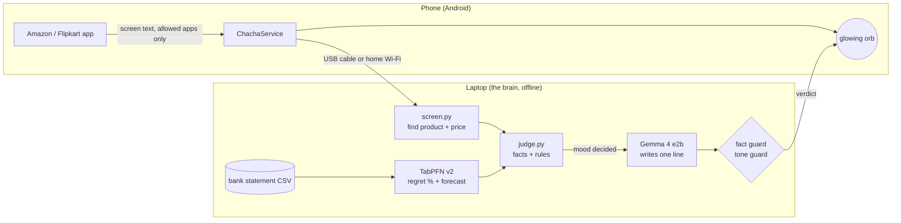

# Checkout Chacha

A glowing orb that sits on top of the Amazon and Flipkart apps on your phone,
watches what you add to your cart, and decides, on your own laptop, whether to
praise you, shrug, or roast you.

It knows your real spending because you give it your bank statement. The
statement, the screens it reads and every verdict stay on your laptop: both
models run locally and there is no cloud API anywhere in the path.

> 🌶🌶🌶 *"Yeh keyboard? ₹11,999? Budget ₹5,000 mein khatam ho jayega, beta."*
> • Regret chance (TabPFN, from your labels): 98%
> • Buy this and your money runs out on day 17

Built for the DEV Hacktoberfest Weekend Challenge: Build for a Friend.

## How it works



1. **The phone only looks.** An Android accessibility service, limited by
   Android itself to the Amazon and Flipkart apps, sends the visible text of
   the screen to the laptop. When the "Add to cart" button turns into
   "Go to cart", it sends the product page.
2. **`screen.py` finds the product.** It finds the selling price first, then
   the title just above it. That keeps the ad strip, carousels and your
   delivery address (which sits below the price) from being mistaken for the
   product.
3. **`statement.py` reads your bank statement.** It works with any Indian
   bank's CSV export: it finds the header row by its column names and pulls the
   shop's name out of UPI lines.
4. **`models.py` runs TabPFN v2.** It does two jobs. *Regret:* you mark around
   40 past purchases "worth it" or "regret", and TabPFN predicts the regret
   chance for anything new from those rows alone, with no training run.
   *Forecast:* it predicts each remaining day of the month, so Chacha knows the
   day your balance would hit zero, with and without the thing in your cart.
5. **`judge.py` decides the mood with plain rules.** Praise, normal or roast.
   The language model never decides, so every verdict can be explained with
   numbers.
6. **`voice.py` asks Gemma 4 to word it.** It runs locally through Ollama.
   Two guards check the line. **Fact guard:** every number must appear in the
   facts. **Tone guard:** mock the purchase, never the person. A line that
   fails either is retried once, then replaced by a template. *Chacha may be
   rude. Chacha may not lie.*

## Why it runs locally

- **Your bank statement and your cart never leave your devices.** No hosted
  API ever sees them.
- **You shouldn't grant screen-reading permission to code you can't read.**
  Chacha reads your shopping screens. Closed source says "trust me"; open
  source says "check me".
- **It costs nothing per roast.** It reacts to every add-to-cart, many times a
  day. A paid API would turn the thing that hunts your subscriptions into one
  of your subscriptions.
- **Open weights let you choose.** This uses TabPFN-2's weights (Apache 2.0
  with attribution) rather than the newer non-commercial ones that need an
  account.

## Run it

You need Python 3.11, [Ollama](https://ollama.com), the Android SDK, and an
Android phone with USB debugging on.

```bash
ollama pull gemma4:e2b
python -m venv .venv
.venv/Scripts/pip install torch --index-url https://download.pytorch.org/whl/cpu
.venv/Scripts/pip install -r brain/requirements.txt
.venv/Scripts/python -m brain
```

The brain prints its address and a pairing code. Open
<http://127.0.0.1:8765> on the laptop for the dashboard: upload your
statement (or use the sample student), label some purchases, set your fun
budget.

Build and install the app, then connect the phone through the cable:

```bash
cd android && ./gradlew assembleDebug
adb install -r app/build/outputs/apk/debug/app-debug.apk
adb reverse tcp:8765 tcp:8765
```

In the Checkout Chacha app, enter `127.0.0.1:8765` and the pairing code, then
turn Chacha on under Accessibility. Open Flipkart or Amazon.

The sample statement is invented: `python scripts/make_sample_statement.py`
regenerates it.

## Tests

```bash
python tests/test_brain.py
```

## Limits

See [docs/CANNOT-DO.md](docs/CANNOT-DO.md).

## Licences

Code: MIT. Built with [TabPFN](https://github.com/PriorLabs/TabPFN) (Prior Labs);
TabPFN-2 weights are used under the Prior Labs License (Apache 2.0 with
attribution): Hollmann et al., *Accurate predictions on small data with a
tabular foundation model*, Nature, 2025. Gemma is used under Google's license
for the Gemma models.
